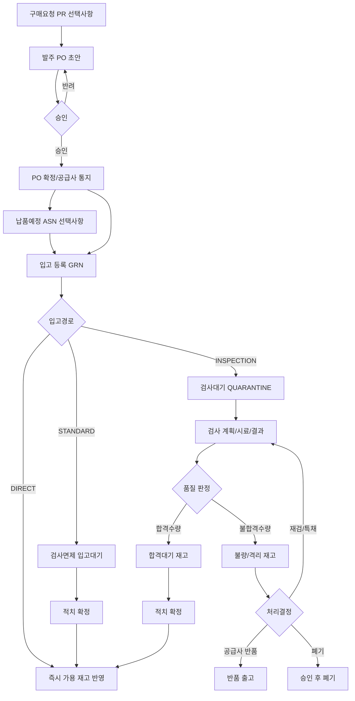

# ProcureFlow AI

제조업 구매자재의 **발주 → 입고 → 수입검사 → 재고 반영**을 다루는 Spring Boot 백엔드입니다.  
구매·창고·품질·재고 담당자가 같은 수량·상태 기준으로 입고부터 가용 전환까지 처리할 수 있게 합니다.

| 항목 | 내용 |
| --- | --- |
| 언어 / 런타임 | Java 21 |
| 프레임워크 | Spring Boot 4.x |
| DB | PostgreSQL 16 + Flyway |
| 기본 패키지 | `com.hopoong.procureflow` |
| 기본 프로파일 | `local` (`application.yaml`) |

---

## 핵심 원칙

- **입고 완료** ≠ **사용 가능 재고**. 입고는 물리 수령, 가용은 검사 합격 후 적치/승인 시점에만 증가한다.
- 승인된 발주만 정상 입고한다. 검사 대상 자재는 합격·적치 전 사용을 금지한다.
- 품목·공급사 정책에 따라 입고 경로를 `DIRECT` / `STANDARD` / `INSPECTION`으로 나눈다.
- 재고는 상태별(검사중·가용·불량 등)로 분리하고, 수량 이동은 원장(ledger)으로 추적한다.

범위 외(연동 접점만): 회계 GL, 세금계산서, AP 3-way match, MRP, 운송비 배부.

---

## 업무 프로세스



### 모듈

| 모듈 | 책임 | 주 사용자 |
| --- | --- | --- |
| 발주 | 거래처·단가·납기·승인·변경·잔량 | 구매담당 / 결재자 |
| 입고 | PO 대조·현품 수량·LOT·부분입고 | 창고 입고담당 |
| 수입검사 | 규격·샘플링·합부판정·부적합 | 품질담당 / 품질승인자 |
| 재고 | 수량 원장·상태·위치·가용량 | 창고 / 재고관리자 |

### 입고 경로

| 경로 | 흐름 | 기본 적용 |
| --- | --- | --- |
| `INSPECTION` | 입고 → 검사격리 → 판정 → 적치 → 가용 | 원재료·중요부품 |
| `STANDARD` | 입고 → 입고대기 → 적치 → 가용 | 검사 면제 승인 품목 |
| `DIRECT` | 입고와 동시에 적치/가용 | 저위험·면제 품목(사전 승인) |

### 개발 단계 (요약)

| 단계 | 범위 |
| --- | --- |
| 1 | 마스터 · PO 승인 · 부분입고 · 검사필수 정책 |
| 2 | 검사 규격·판정·불합격 · 적치 · 원장 |
| 3 | 반품/역분개 · LOT/시리얼 · 실사·대사 |
| 4 | ASN/바코드 · CoA 보조 · 공급사 평가 · AP 인터페이스 |

상세 설계·상태 모델·API 제안은 `docs/`에 정리한다.

---

## 저장소 구조

```text
procureflow-ai/
├── AGENTS.md             AI 에이전트 작업 규칙 (단일 원본)
├── CLAUDE.md             Claude → AGENTS.md
├── README.md             이 파일
├── docker-compose.yml    로컬 PostgreSQL
├── convention/           공통 코딩·API·커밋 규칙
├── docs/                 아키텍처·기능·가이드·ADR·런북
└── src/                  Spring Boot 애플리케이션
```

| 문서 | 용도 |
| --- | --- |
| [AGENTS.md](AGENTS.md) | Codex / Cursor / Claude 공통 진입 |
| [convention/README.md](convention/README.md) | 코딩·커밋·PR 관례 |
| [docs/README.md](docs/README.md) | 아키텍처·기능 문서 (패키지와 경로 정렬) |

---

## 로컬 실행

요구사항: **JDK 21**, **Docker**, Gradle Wrapper 포함.

### 1. PostgreSQL

```bash
docker compose up -d
```

| 항목 | 기본값 (`docker-compose.yml`) |
| --- | --- |
| host / port | `localhost:5432` |
| database | `procureflow` |
| user / password | `procureflow` / `procureflow` |

앱은 `DB_URL`, `DB_USERNAME`, `DB_PASSWORD`로 덮어쓸 수 있다.  
`local` 프로파일에서 미지정 시 위 기본값을 쓴다.

### 2. 애플리케이션

```bash
./gradlew bootRun
```

Windows:

```bat
gradlew.bat bootRun
```

- 포트: **8080** (`application-local.yaml`)
- 프로파일 미지정 시 `local`
- 기동 시 Flyway가 `src/main/resources/db/migration`을 적용한다
- Swagger UI: [http://localhost:8080/swagger-ui.html](http://localhost:8080/swagger-ui.html) (`local`만 활성)

```bash
./gradlew test
```

테스트는 Testcontainers로 PostgreSQL을 띄운다 (Docker 필요).  
운영·공유 환경의 비밀값은 `application*.yaml`에 넣지 않고 환경 변수로 주입한다.

---

## 참고

- 기능 문서는 코드 패키지와 맞춘다: `docs/features/<패키지>/` ← `com.hopoong.procureflow.<패키지>`
