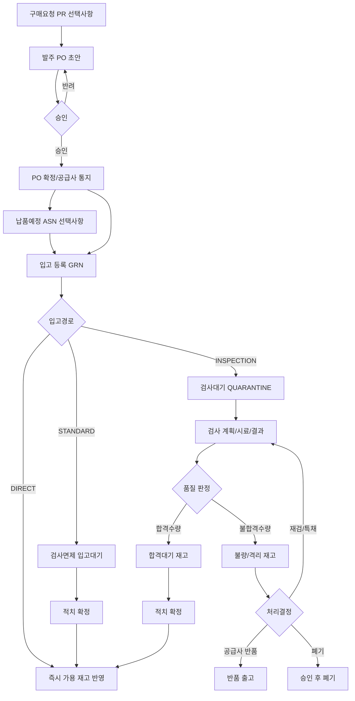

# ProcureFlow AI

제조업 구매자재의 **발주 → 입고 → 수입검사 → 재고 반영**을 다루는 Spring Boot 백엔드입니다.

SAP S/4HANA · Oracle Fusion SCM · Dynamics 365의 공개 기능을 벤치마크한 설계를 기준으로 하며, 특정 ERP DB·비공개 운영 절차를 복제하지 않습니다.

| 항목 | 내용 |
| --- | --- |
| 언어 / 런타임 | Java 21 |
| 프레임워크 | Spring Boot 4.x |
| 기본 패키지 | `com.hopoong.procureflow` |
| 기본 프로파일 | `local` (`application.yaml`) |

---

## 핵심 원칙

- **입고 완료** ≠ **사용 가능 재고**. 입고는 물리 수령, 가용은 검사 합격 후 적치/승인 시점에만 증가한다.
- 승인된 발주만 정상 입고한다. 검사 대상 자재는 합격·적치 전 사용을 금지한다.
- 품목·공급사 정책에 따라 입고 경로를 `DIRECT` / `STANDARD` / `INSPECTION`으로 나눈다.
- 재고는 상태별(검사중·가용·불량 등)로 분리하고, 수량 이동은 원장(ledger)으로 추적한다.

범위 외(연동 접점만): 회계 GL, 세금계산서, AP 3-way match, MRP, 운송비 배부.

---

## 업무 프로세스



### 모듈

| 모듈 | 책임 | 주 사용자 |
| --- | --- | --- |
| 발주 | 거래처·단가·납기·승인·변경·잔량 | 구매담당 / 결재자 |
| 입고 | PO 대조·현품 수량·LOT·부분입고 | 창고 입고담당 |
| 수입검사 | 규격·샘플링·합부판정·부적합 | 품질담당 / 품질승인자 |
| 재고 | 수량 원장·상태·위치·가용량 | 창고 / 재고관리자 |

### 입고 경로

| 경로 | 흐름 | 기본 적용 |
| --- | --- | --- |
| `INSPECTION` | 입고 → 검사격리 → 판정 → 적치 → 가용 | 원재료·중요부품 |
| `STANDARD` | 입고 → 입고대기 → 적치 → 가용 | 검사 면제 승인 품목 |
| `DIRECT` | 입고와 동시에 적치/가용 | 저위험·면제 품목(사전 승인) |

### 개발 단계 (요약)

| 단계 | 범위 |
| --- | --- |
| 1 | 마스터 · PO 승인 · 부분입고 · 검사필수 정책 |
| 2 | 검사 규격·판정·불합격 · 적치 · 원장 |
| 3 | 반품/역분개 · LOT/시리얼 · 실사·대사 |
| 4 | ASN/바코드 · CoA 보조 · 공급사 평가 · AP 인터페이스 |

상세 설계·상태 모델·API 제안은 `docs/`에 정리한다.

---

## 저장소 구조

```text
procureflow-ai/
├── AGENTS.md          AI 에이전트 작업 규칙 (단일 원본)
├── CLAUDE.md          Claude → AGENTS.md
├── README.md          이 파일
├── convention/        공통 코딩·API·커밋 규칙
├── docs/              아키텍처·기능·가이드·ADR·런북
└── src/               Spring Boot 애플리케이션
```

| 문서 | 용도 |
| --- | --- |
| [AGENTS.md](AGENTS.md) | Codex / Cursor / Claude 공통 진입 |
| [convention/README.md](convention/README.md) | 코딩·커밋·PR 관례 |
| [docs/README.md](docs/README.md) | 아키텍처·기능 문서 (패키지와 경로 정렬) |

---

## 로컬 실행

요구사항: **JDK 21**, Gradle Wrapper 포함.

```bash
./gradlew bootRun
```

Windows:

```bat
gradlew.bat bootRun
```

기본 포트는 `application-local.yaml` 기준 **8080**.  
프로파일을 지정하지 않으면 `local`이 기본이다.

```bash
./gradlew test
```

비밀값(DB 비밀번호, API 키 등)은 `application*.yaml`에 넣지 않고 환경 변수로 주입한다.

---

## 참고

- 기능 문서는 코드 패키지와 맞춘다: `docs/features/<패키지>/` ← `com.hopoong.procureflow.<패키지>`
