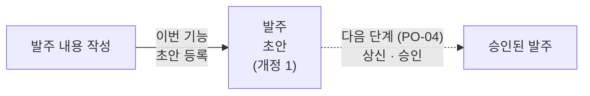
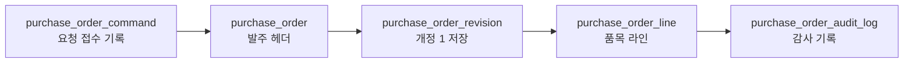

# purchaseorder(발주).PO-01 초안 생성

> **검토자용.** 이 기능이 무엇을 하는지 설명한다.
> 필드 규칙 · 에러 코드 전체 · 요청/응답 스펙은 [purchaseorder 명세](../README.md#purchaseorder발주초안-생성)를 본다.

## 한 줄 요약

**공급사에 무엇을 얼마에 살지 적은 발주서를 "초안" 상태로 처음 등록하는 기능**이다.
등록만 할 뿐, 아직 결재되거나 공급사에 보내지지 않는다.

---

## 1. 왜 필요한가

발주는 결재를 받고 공급사에 보내기 전에 먼저 내용을 작성해 두는 단계가 있다.
이 기능은 그 첫 단계로, 발주 번호를 붙이고 내용을 저장해 둔다.

이번 기능은 **왼쪽 화살표까지**다.

---

## 2. 예시

담당자가 공급사 "A상사"에 볼트와 너트를 주문하는 발주를 작성한다 (통화: 원화, 입고 창고: 1창고).

| 라인 | 품목 | 수량 | 단가 |
| --- | --- | --- | --- |
| 1 | 볼트 | 10 | 1,500 |
| 2 | 너트 | 10 | 1,500 |

**결과**

| 항목 | 값 |
| --- | --- |
| 발주 번호 | `PO-20261022-00000001` (서버가 자동으로 붙임) |
| 상태 | 초안 |
| 개정 번호 | 1 |
| 라인 | 2개, 번호는 적은 순서대로 1, 2 |

- 발주 번호 형식: `PO-{날짜}-{8자리 일련번호}`. 동시에 여러 건이 들어와도 겹치지 않는다.
- 등록과 함께 발주 전체 내용이 개정 1 로 통째로 저장된다. 나중에 개정(PO-02)할 때 이 내용이 "바꾸기 전" 기준이 된다.

---

## 3. 테이블에 남는 것

발주 1건이 성공하면 아래 순서로 한 번에 저장된다. 중간에 하나라도 실패하면 전부 취소된다.

| 테이블 | 하는 일 | 위 예시에서 남는 것 |
| --- | --- | --- |
| `purchase_order_command` | 요청 접수 기록. 같은 요청이 다시 와도 두 번 만들지 않게 한다 | 요청 1건, 만들어진 발주를 가리킴 |
| `purchase_order` | **발주 헤더.** 발주 번호 · 공급사 · 통화 · 입고 창고 · 상태 | `PO-20261022-00000001`, A상사, 원화, 1창고, 초안, 유효 개정 = 1 |
| `purchase_order_revision` | 발주 전체 내용을 개정 단위로 통째로 보관 | 개정 1 (초안), 볼트 10 · 너트 10 |
| `purchase_order_line` | 품목 라인 | 라인 1 볼트 10개 · 라인 2 너트 10개 |
| `purchase_order_audit_log` | 누가 · 언제 만들었는지 기록 | "생성", 작성자, 시각 |

---

## 4. 무엇을 확인하나

| 확인 | 내용 |
| --- | --- |
| 사업장 · 창고 · 공급사 · 품목 | 우리 조직 것이고 사용 중인지. 창고는 그 사업장 소속인지, 품목은 구매 가능한지 |
| 단가 | 소수점이 통화 단위를 넘지 않는지 (예: 원화는 소수점 없음) |
| 통화 | 인식 가능한 통화인지 (`KRW`, `USD` 등) |
| 수량 · 세율 · 입고 방식 | 수량 > 0, 세율 0~1, 검사 입고면 검사 기준이 있는지 |

---

## 5. 언제 거절되나

| 상황 | 결과 |
| --- | --- |
| 필수 값 누락 · 형식 오류 (수량 0, 라인 없음 등) | 400 요청 오류 |
| 단가 소수점이 통화 단위보다 많음 (예: 원화 `1500.5`) | 422 단가 오류 |
| 쓸 수 없는 사업장 · 창고 · 공급사 | 422 |
| 구매할 수 없는 품목 | 422 품목 오류 (몇 번째 라인인지 알려줌) |

거절되면 **아무것도 저장되지 않는다.** (발주 번호는 건너뛸 수 있다. 정상이다.)

---

## 6. 같은 요청이 두 번 들어오면

| 상황 | 결과 |
| --- | --- |
| 네트워크 문제 등으로 같은 요청을 다시 보냄 | 새로 만들지 않고 처음 만든 발주를 그대로 돌려준다 |
| 같은 요청 키로 다른 내용을 보냄 | 409 거절 |
| 같은 요청이 동시에 두 번 들어옴 | 발주는 1건만 만들어지고, 둘 다 같은 발주를 받는다 |
