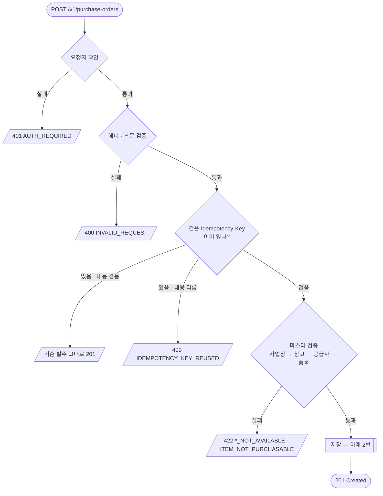
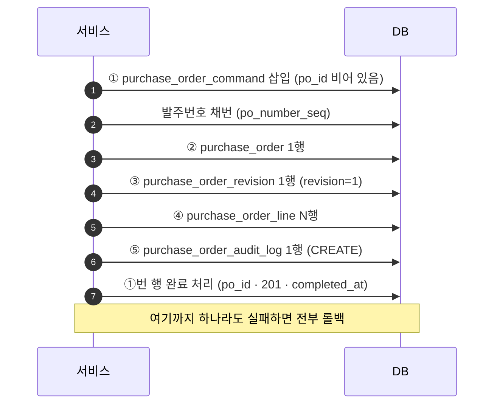

# purchaseorder(발주).PO-01 초안 생성 — 저장 흐름

> **검토자용 (개발자 · 총괄).** 요청이 들어와서 DB에 저장되기까지의 전체 흐름과, 어느 테이블에 무엇이 쌓이는지를 다룬다.
> 필드 검증 규칙 · 에러 코드 전체 · 요청/응답 스펙은 [purchaseorder 명세](../README.md#purchaseorder발주초안-생성)를 본다.

## 요약


| 질문            | 답                               |
| ------------- | ------------------------------- |
| 무엇을 하나        | 발주 **초안(**`DRAFT`**) 1건**을 등록한다 |
| API           | `POST /v1/purchase-orders`      |
| 몇 개 테이블에 쓰나   | **5개**, 한 트랜잭션                  |
| 중간에 실패하면      | **전부 롤백.** 흔적이 남지 않는다           |
| 같은 요청을 다시 보내면 | 새로 만들지 않고 **기존 발주를 그대로 돌려준다**   |
| 외부로 나가는 것     | 없다 (`outbox_event` 미기록)         |


---

## 1. 전체 흐름

요청 하나가 거치는 단계. 위에서 아래로, 앞 단계를 통과해야 다음으로 간다.




---


## 2. 저장 순서 (한 트랜잭션)




**①을 가장 먼저 쓰고 가장 나중에 완료 처리하는 이유:** "이 요청을 받았다"를 먼저 남겨야 같은 키의 중복 요청을 막을 수 있고, 모든 저장이 끝난 뒤에야 결과(`po_id`)를 채울 수 있기 때문이다.

발주번호 형식: `PO-{yyyyMMdd}-{8자리}` (예: `PO-20261022-00000001`)

---


## 3. 테이블별 저장 내용


| #   | 테이블                        | 역할                             | 행 수  | 저장되는 값                                                                               |
| --- | -------------------------- | ------------------------------ | ---- | ------------------------------------------------------------------------------------ |
| ①   | `purchase_order_command`   | 요청 접수 기록 · 멱등 처리 (같은 요청 중복 방지) | 1    | `command_type=CREATE_PURCHASE_ORDER`, 멱등 키, 요청 해시, 결과 `po_id`, `response_status=201` |
| ②   | `purchase_order`           | 발주 헤더 (발주의 현재 상태)              | 1    | 발주번호, 공급사, 사업장, 입고 창고, 통화, `status=DRAFT`, `current_revision=1`                      |
| ③   | `purchase_order_revision`  | 개정 이력 (발주 내용 스냅샷 보관)           | 1    | `revision=1`, `revision_status=DRAFT`, 발주 전체 내용 JSON(`after_snapshot`) + 해시          |
| ④   | `purchase_order_line`      | 발주 품목 라인                       | 품목 수 | 품목, 수량, 단가, 세금, 납기, 입고 방식 · `line_no` 1부터, `line_status=ACTIVE`                      |
| ⑤   | `purchase_order_audit_log` | 감사 로그 (누가 · 언제 · 무엇을 했는지)      | 1    | `action=CREATE`, 작성자, 시각, 요청 추적 ID(`correlation_id`)                                 |


**예시 — 품목 3개짜리 발주 1건:** `purchase_order` 1 · `purchase_order_line` **3** · 나머지 3개 테이블 각 1행.

---


## 4. 실패 · 재전송 시 동작


| 상황                               | 결과           | DB 상태               |
| -------------------------------- | ------------ | ------------------- |
| 400 · 409 · 422 · 500            | 에러 응답        | 5개 테이블 모두 **변화 없음** |
| 같은 `Idempotency-Key` + 같은 내용 재전송 | 기존 발주 그대로 반환 | **행이 늘지 않음**        |
| 같은 `Idempotency-Key` + 다른 내용     | 409          | 변화 없음               |


> 실패해도 **발주번호는 건너뛸 수 있다.** 시퀀스는 롤백되지 않으며 정상 동작이다.

---


## 5. 확인 SQL

발주번호로 1건의 저장 결과를 확인한다.

```sql
-- 헤더 (결과의 id 를 아래 :po_id 로 사용)
SELECT id, po_number, status, current_revision
FROM purchase_order
WHERE po_number = 'PO-20261022-00000001';

-- 나머지 4개 테이블 행 수
SELECT 'revision'  AS t, count(*) FROM purchase_order_revision  WHERE po_id = :po_id
UNION ALL
SELECT 'line',           count(*) FROM purchase_order_line      WHERE po_id = :po_id
UNION ALL
SELECT 'audit_log',      count(*) FROM purchase_order_audit_log WHERE po_id = :po_id
UNION ALL
SELECT 'command',        count(*) FROM purchase_order_command   WHERE po_id = :po_id;
```

