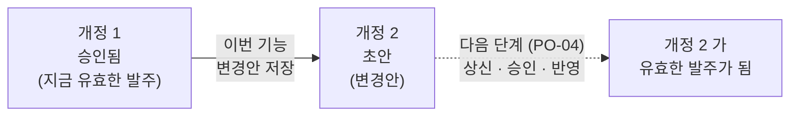
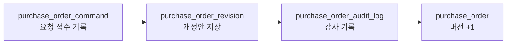

# purchaseorder(발주).PO-02 개정 초안 작성

> **검토자용.** 이 기능이 무엇을 하는지 설명한다.
> 필드 규칙 · 에러 코드 전체 · 요청/응답 스펙은 [purchaseorder 명세](../README.md#purchaseorder발주개정-초안-작성)를 본다.

## 한 줄 요약

**이미 승인된 발주를 바꾸고 싶을 때, 바꿀 내용을 "개정안"으로 따로 저장해 두는 기능**이다.
저장만 할 뿐, 실제 발주 내용은 아직 바뀌지 않는다.

---

## 1. 왜 필요한가

승인된 발주는 공급사에 나간 계약 문서다. 수량이나 단가를 바꿀 일이 생겨도 원본을 바로 고치면 안 된다.
누가 · 왜 · 무엇을 바꾸려 했는지 남기고, 다시 승인을 받은 뒤에 반영해야 한다.

그래서 변경 내용을 **원본 옆에 새 번호(개정 번호)를 붙여 따로 보관**한다.

이번 기능은 **왼쪽 화살표까지**다.

---

## 2. 예시

발주 `PO-20261022-00000001` 이 승인되어 있다.

| 라인 | 품목 | 수량 | 단가 |
| --- | --- | --- | --- |
| 1 | 볼트 | 10 | 1,500 |
| 2 | 너트 | 10 | 1,500 |

담당자가 "볼트를 12개로 늘리고, 와셔를 하나 추가하자"는 개정을 요청한다 (사유: 수량 변경).

**결과**

| | 개정 1 (지금 유효한 발주) | 개정 2 (변경안, 초안) |
| --- | --- | --- |
| 라인 1 볼트 | 10 | **12** |
| 라인 2 너트 | 10 | 10 |
| 라인 3 와셔 | - | **새로 추가** |
| 상태 | 승인 | 초안 |

- 발주 화면 · 입고 기준은 여전히 **개정 1** 이다. 볼트는 10개, 라인은 2개.
- 개정 2 는 "이렇게 바꾸고 싶다"는 기록으로만 남는다.
- 개정 2 에는 바꾸기 전 내용과 바꾼 후 내용이 통째로 함께 저장되어, 나중에 무엇이 달라졌는지 비교할 수 있다.

---

## 3. 테이블에 남는 것

개정 요청 1건이 성공하면 아래 순서로 한 번에 저장된다. 중간에 하나라도 실패하면 전부 취소된다.

| 테이블 | 하는 일 | 위 예시에서 남는 것 |
| --- | --- | --- |
| `purchase_order_command` | 요청 접수 기록. 같은 요청이 다시 와도 두 번 만들지 않게 한다 | 요청 1건, 만들어진 개정 2 를 가리킴 |
| `purchase_order_revision` | **개정안 본체.** 바꾸기 전 · 바꾼 후 내용을 통째로 보관 | 개정 2 (초안), 사유 "수량 변경", 전: 볼트 10 · 라인 2개 / 후: 볼트 12 · 라인 3개 |
| `purchase_order_audit_log` | 누가 · 언제 · 왜 개정했는지 기록 | "개정 작성", 작성자, 시각, 사유 |
| `purchase_order` | 발주 헤더. **내용은 그대로**, 버전 번호만 1 올린다 (다른 사람이 같은 발주를 동시에 개정하지 못하게) | 유효 개정 = 1 그대로, 버전 0 → 1 |
| `purchase_order_line` | **건드리지 않는다** | 볼트 10 · 너트 10, 라인 2개 그대로 |

---

## 4. 무엇을 바꿀 수 있나

| 바꿀 수 있음 | 바꿀 수 없음 |
| --- | --- |
| 라인 수량 · 단가 · 세금 · 납기 · 입고 방식 | 공급사 |
| 라인 추가 | 사업장 |
| 라인 취소 | 통화 |
| 입고 창고 · 환율 · 결제 조건 · 인코텀즈 | 기존 라인의 품목 (품목을 바꾸려면 취소 후 새 라인) |

---

## 5. 언제 거절되나

| 상황 | 결과 |
| --- | --- |
| 발주가 없거나 다른 조직의 발주 | 404 발주 없음 |
| 아직 승인 전이거나, 이미 입고 완료 · 종결 · 취소된 발주 | 409 개정할 수 없는 상태 |
| 이미 진행 중인(초안 · 결재 중) 개정이 있음 | 409 진행 중인 개정 있음 — **개정은 한 번에 하나만** |
| 그 사이 다른 사람이 먼저 개정함 | 409 버전 충돌 — 최신 내용을 다시 보고 요청 |
| 기존 라인을 빠뜨렸거나, 같은 라인을 두 번 적음 | 422 라인 오류 |
| 이미 마감된 수량보다 적게 줄임 | 422 라인 오류 |
| 단가 소수점이 통화 단위보다 많음 (예: 원화 `1500.5`) | 422 단가 오류 |
| 쓸 수 없는 창고 · 품목 | 422 |
| 지금 발주와 달라진 게 없음 | 422 변경 없음 |

거절되면 **아무것도 저장되지 않는다.**

---

## 6. 같은 요청이 두 번 들어오면

| 상황 | 결과 |
| --- | --- |
| 네트워크 문제 등으로 같은 요청을 다시 보냄 | 새로 만들지 않고 처음 만든 개정을 그대로 돌려준다 |
| 두 사람이 동시에 같은 발주를 개정 | 한 명만 성공, 다른 한 명은 버전 충돌 |

---

## 7. 개정 이력 보기

| 기능 | 보여주는 것 |
| --- | --- |
| 개정 목록 | 이 발주의 개정들을 최신순으로 (번호 · 상태 · 사유 · 작성자 · 시각) |
| 개정 상세 | 한 개정의 바꾸기 전 / 바꾼 후 전체 내용 |
